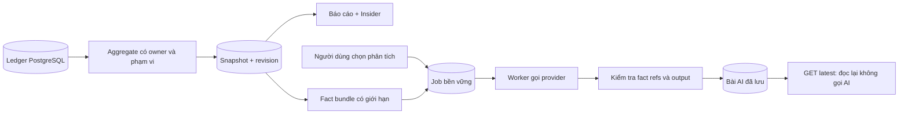

# Báo cáo trực quan, Money Insider và bài phân tích AI được lưu lại

## 1. Phạm vi và trạng thái

Yêu cầu của chủ sản phẩm: biểu đồ đẹp hơn, thông tin dễ hiểu hơn; không dùng danh sách giao dịch dài làm nội dung chính; SQL xử lý số liệu để giảm việc và chi phí cho AI; bài phân tích sâu phải được lưu, lần sau vào xem được ngay. Giữ màu, kích thước chữ và base hiện tại. Không chạy automated test theo chỉ dẫn mới nhất; thực hiện build và UAT thủ công khi triển khai xong.

Thiết kế đã được triển khai thành **local candidate** cho iOS + backend, giữ tương thích API cũ. Migration additive 000053, report snapshot/target, latest-analysis lookup, cache bảo vệ và shared chart bases đã có trong source. Backend/simulator build và UAT rich-data cơ bản đã qua; automated tests, provider-backed analysis, physical device và production vẫn là gate mở.

Liên kết: [Backlog](../BACKLOG.md), [Context](../../CONTEXT.md), [page contract](../../design/pages/reports/README.md), [ADR-027](../../decisions/ADR-027-report-snapshots-and-grounded-analysis.md), [plan trước](../../superpowers/plans/2026-10-31-reports-insider.md), [plan triển khai mới](../../superpowers/plans/2026-11-01-reports-insider-visual-and-saved-analysis.md), [Validation Matrix](../VALIDATION_MATRIX.md), [release notes](../../releases/CHANGELOG.md). Work item này tự chứa ticket + detail design; không tạo phase mới.

Thiết kế này thay hướng UI native cũ: không lấy danh sách top giao dịch và vòng phần trăm tăng/giảm làm trung tâm; không coi bố cục web cũ là chuẩn cho native. Khi triển khai mới cập nhật hợp đồng màn hình thành trạng thái đã thực hiện.

## 2. Kết quả người dùng cần đạt

| Bề mặt | Câu hỏi phải trả lời | Dữ liệu và hành động |
|---|---|---|
| Báo cáo | Tháng này thu/chi bao nhiêu? Chi vào đâu? Thay đổi ở đâu? | Số tổng, xu hướng, cơ cấu, yếu tố tăng/giảm; chạm để xem giao dịch phù hợp |
| Money Insider trên Tổng quan | Điều gì đáng chú ý nhất lúc này? | 1 nhận xét chính, tối đa 2 nhận xét phụ; mở đúng phần Báo cáo |
| Phân tích AI trong Báo cáo | Tôi nên hiểu các số liệu này thế nào, có thể làm gì tiếp? | Bài có bằng chứng, được lưu; cập nhật theo yêu cầu; hỏi tiếp trong Assistant |

Không gọi AI khi mở màn hình, đổi tháng, chọn ví, chạm biểu đồ hoặc đọc lại bài cũ. Không cron AI nửa đêm trong phiên bản này. Cron chỉ phục vụ dọn dữ liệu hết hạn và xử lý job đã được yêu cầu. Không thêm điểm sức khỏe tài chính, khẳng định nguyên nhân chi tiêu, dự báo chắc chắn hay tư vấn mua/bán tài sản.

## 3. Requirement chức năng

| ID | Yêu cầu | Điều kiện chấp nhận |
|---|---|---|
| R01 | Phạm vi tháng và ví rõ ràng | Bộ chọn tháng native, mặc định tháng hiện tại theo tài khoản; chọn Tất cả ví hoặc một ví. Không yêu cầu nhập YYYY-MM hoặc hiện mã múi giờ |
| R02 | Tóm tắt nhanh | Hiện Thu, Chi, Chênh lệch thu–chi. Chênh lệch không được gọi là số dư tài khoản hoặc số tiền tiết kiệm |
| R03 | Xu hướng có thể đọc và chạm | Đường chi lũy kế hiện tại + kỳ trước; chọn ngày xem giá trị và khoảng thời gian. Có chế độ Thu/Chi theo tuần |
| R04 | Cơ cấu chi tiêu | Donut + danh sách ngắn có số tiền/tỷ trọng; tối đa 5 nhóm đứng đầu + Khác; nhãn nhóm rõ; mở drill-down đúng nhóm |
| R05 | Giải thích biến động | Tối đa 3 nhóm làm chi tiêu tăng/giảm nhiều nhất theo số tiền; so sánh cùng số ngày hoàn tất; thiếu dữ liệu phải nói rõ |
| R06 | Insider hữu ích | Dùng cùng snapshot và quy tắc với Báo cáo; không gọi legacy Insider riêng; mỗi nhận xét có bằng chứng và đích mở cụ thể |
| R07 | AI lưu và khôi phục | Vào lại màn, mở lại app hoặc đăng nhập thiết bị khác vẫn tìm được bài cùng phạm vi còn thời hạn lưu |
| R08 | Phân biệt cũ và mới | Bài cũ vẫn đọc được khi dữ liệu thay đổi; có thời điểm phân tích và trạng thái cần cập nhật; chỉ tạo bài mới khi người dùng yêu cầu |
| R09 | Job bền vững | Rời màn không mất job; quay lại theo dõi job đang chạy. Bấm hai lần hoặc retry do mất mạng không nhân đôi công việc |
| R10 | Dùng chung base | Chart, tooltip, legend, insight, AI article, picker đều là base; màn chỉ sắp bố cục và truyền dữ liệu |
| R11 | Đọc được khi lỗi/offline | Bản lưu hiển thị trước nếu có, kèm trạng thái; lỗi tải mới không xoá nội dung đang đọc; không trộn dữ liệu giữa ví/tháng/user |
| R12 | Riêng tư và tiếp cận | Chế độ ẩn tiền áp dụng cả chart, tooltip, AI, VoiceOver. Điều khiển tối thiểu 44pt; chữ lớn không mất nút/nội dung |

## 4. Thiết kế màn hình và tương tác

### 4.1. Báo cáo

Thứ tự dọc, không carousel che khuất nội dung:

```text
Báo cáo                         [tháng trước / Tháng 11 / tháng sau]
[Tất cả ví ▾]

Chênh lệch thu–chi                <giá trị chính>
Thu <giá trị>                     Chi <giá trị>
So sánh 01–10/11 với 01–10/10     <trạng thái có nghĩa>

Xu hướng                  [Chi lũy kế | Thu / Chi]
<đường hiện tại; đường đứt kỳ trước; chạm xem ngày>
<hoặc cột thu/chi theo tuần, trục chung>

Chi vào đâu?
<donut nhỏ + tổng chi; nhóm xếp hạng với tiền và tỷ trọng>

Điều gì thay đổi?
<tối đa 3 thanh ngang tăng/giảm quanh mốc 0>
<một câu giải thích số tiền + kỳ so sánh>

Phân tích AI                 <thời điểm / bản lưu / có dữ liệu mới>
<tóm tắt; tối đa 3 nhận xét; tối đa 3 gợi ý có bằng chứng>
[Phân tích sâu / Cập nhật phân tích]       [Hỏi tiếp]
```

Trên màn nhỏ, donut xếp trên danh sách thay vì ép hai cột. Ngân sách vượt/ngần ngưỡng hoặc hũ chỉ xuất hiện qua insight liên quan; không thêm cả danh sách ngân sách/hũ làm màn dài. Các giao dịch chỉ được tải sau khi mở chi tiết.

Phong cách: dùng khoảng trắng để chia phần; một surface cho mỗi khối thông tin, không lồng nhiều card. Số tổng nổi bật bằng vai trò font sẵn có; tiêu đề section giữ nhỏ gọn. Gradient nhẹ ở vùng dưới đường và tổng quan dùng token hiện tại, không tạo bảng màu xanh mới. Legend và nhãn trực tiếp thay cho giải thích chỉ bằng màu. Không 3D, hiệu ứng phát sáng, chart trang trí hay vòng tròn biểu diễn phần trăm tăng/giảm.

### 4.2. Quy tắc biểu đồ

| Biểu đồ | Hình thức | Chạm/đọc | Trường hợp đặc biệt |
|---|---|---|---|
| Chi lũy kế | LineMark thẳng, AreaMark nhẹ; kỳ này nét liền, kỳ trước nét đứt | RuleMark tại ngày; tooltip có ngày, tổng lũy kế, chi riêng ngày, kỳ trước; nút xem chi ngày đã chọn | Không nối mượt làm sai giá trị; ngày chưa xảy ra không vẽ thành 0; ngày đã qua không chi vẫn tồn tại |
| Thu / Chi | Cột cặp theo tuần, chung mốc 0, nhãn tuần là khoảng ngày | Chọn một tuần để xem cả hai giá trị; chọn loại trong chi tiết | Tuần đầu/cuối chỉ gồm ngày thuộc tháng; giá trị 0 không vẽ cột tối thiểu giả |
| Cơ cấu | SectorMark donut, màu ổn định theo category ID, kết hợp hàng tên/tiền/% | Chọn sector làm nổi hàng tương ứng; bấm hàng mở giao dịch | Không chi: empty state, không donut giả. “Khác” có bộ lọc riêng; “Chưa phân loại” có nghĩa riêng |
| Biến động | Thanh ngang hai phía mốc 0, xếp theo trị tuyệt đối số tiền thay đổi | Hiện +/− số tiền, tên nhóm, kỳ so sánh; mở các giao dịch của nhóm trong kỳ đang xem | Không mặc định tăng là xấu/giảm là tốt; khi kỳ trước 0 dùng “Phát sinh mới”, không Infinity |

Màu danh mục lấy từ catalog/token đang có; màu chỉ là hỗ trợ, không phải định danh duy nhất. Nhãn số dùng formatter tiền chung, trục có thể rút gọn “tr”, tooltip hiện đầy đủ. Tiền tính bằng integer/decimal nghiệp vụ; chỉ chuyển Double tại ranh giới vẽ chart.

Không cố hiển thị tất cả nhãn ngày; trục x dùng các mốc thưa theo chiều rộng. Chart thường cao khoảng 180–220pt qua variant base, tự tăng khi accessibility text lớn. Reduce Motion tắt animation biến đổi đường/cột; animation thông thường chỉ ngắn ở đổi phạm vi. Không dùng animation đếm tiền gây đổi dữ liệu liên tục.

### 4.3. Money Insider

Giữ tên Money Insider hiện có trong phạm vi này. Card gọn gồm một tiêu đề nhận xét, một bằng chứng số và CTA cụ thể. Ví dụ minh hoạ, không phải dữ liệu thật: “Ăn uống tăng 320.000 đ” + “10 ngày đầu tháng so với cùng kỳ” + “Xem nhóm Ăn uống”. Không chỉ hiện “−25,2%” trong vòng tròn.

Thứ tự ưu tiên: ngân sách vượt hạn mức → khoản tăng chi đáng kể → khoản giảm chi đáng kể → mô tả cơ cấu/no-data. Trong cùng mức ưu tiên, xếp độ lớn ảnh hưởng tiền trước, ID làm tie-breaker. Tối đa 3 insight; tránh cả ba lặp lại cùng một nhóm. Chưa đủ cơ sở so sánh thì dùng mô tả trung tính, không ép sinh nhận xét.

Overview lấy insight từ snapshot báo cáo tháng hiện tại, cùng ví nếu có scope ví. CTA mang month/wallet/section/category xuống Reports. Dùng snapshot chung nên không có hai con số khác nhau cho cùng phạm vi tại cùng revision. Không đổi thứ tự navigation toàn app trong task này.

### 4.4. Bài AI

Một phần đọc như bài ngắn, không biến mỗi câu thành một card. Đầu bài ghi “Phân tích ngày …”, phạm vi tháng/ví bằng tiếng Việt. Mặc định hiện tóm tắt và các điểm chính; mở rộng nội dung khi cần. Bằng chứng có thể chạm để xem số liệu/biểu đồ nguồn. CTA “Hỏi tiếp” mở Assistant toàn màn, mang analysis ID + snapshot ID + scope; server xác thực lại quyền truy cập. Không gửi toàn bộ ledger hay tự động gửi một tin nhắn mới.

| Trạng thái | Hiển thị | Hành động |
|---|---|---|
| Chưa có bài | Giải thích ngắn lợi ích | “Phân tích sâu” khi có dữ liệu phù hợp |
| Có bài đúng dữ liệu | Hiện ngay bài đã lưu | “Hỏi tiếp”; không mời tạo lại cùng dữ liệu |
| Có bài cũ | Giữ bài, ghi “Có dữ liệu mới” hoặc “Kỳ so sánh đã thay đổi” | “Cập nhật phân tích” |
| Đang cập nhật, có bài cũ | Vẫn đọc được bài cũ, badge đang cập nhật | Theo dõi/hủy, không thay toàn màn bằng spinner |
| Đang chạy, chưa có bài | Trạng thái queued/running, không % tiến độ giả | Có thể rời màn, quay lại; có hủy |
| Lỗi tạo bài mới | Giữ bài cũ nếu có, lỗi gọn tại action | Retry chủ động; không tự gọi lại provider |
| Offline | Bản lưu + chưa kiểm tra cập nhật | Đọc tiếp; nút tạo/cập nhật cần mạng |
| Hết thời hạn lưu | Không hiển thị nội dung đã hết hạn từ cache | Giải thích chưa có bản phân tích còn lưu, cho tạo mới |

Mặc định giữ chính sách lưu **90 ngày** hiện có của backend, tính từ lúc tạo bản phân tích; đây không phải cam kết lưu vĩnh viễn. Thời hạn trả về từ server, không hard-code riêng trên app. Nếu cần lưu lịch sử lâu dài sẽ là thay đổi retention riêng. Mốc hết freshness của snapshot lúc nửa đêm không được làm bài AI biến mất hôm sau.

## 5. Hợp đồng số liệu

### 5.1. Phạm vi và tính toán

- Owner lấy từ principal đã xác thực, tuyệt đối không tin owner ID do client gửi. Ví phải thuộc owner. Tất cả query aggregate và drill-down dùng chung eligibility hiện có: giao dịch được đưa vào báo cáo; loại trừ transfer, adjustment, credit-payment hệ thống theo canonical rule.
- Múi giờ lấy từ cấu hình tài khoản. App dùng trường timezone trả về để xử lý ngày, không tự thay bằng múi giờ điện thoại; UI chỉ hiện ngày dễ đọc. Đổi múi giờ làm scope/cache cũ mất hiệu lực.
- Tiền VND lưu/tính integer đơn vị đồng; chặn overflow. Không cộng lẫn currency nếu dữ liệu hỗ trợ thêm tiền tệ: phải dùng hợp đồng quy đổi đã có hoặc báo chưa hỗ trợ, không tự đoán tỷ giá.
- `income = Σ thu`, `expense = Σ chi`, `net = income − expense`. Không suy ra tổng tài sản hoặc số dư ví từ net.
- `current_range` là tháng theo lịch tài khoản, giới hạn bởi thời điểm đọc cho tháng đang mở. Khoảng thời gian dùng `[start, end_exclusive)`. Ngày tương lai không xuất hiện trong series hiện tại.
- Số tổng và cơ cấu sử dụng toàn bộ phần tháng đang xem đến `as_of`, gồm hôm nay. So sánh biến động sử dụng **các ngày đã hoàn tất**: tháng hiện tại bỏ hôm nay; kỳ trước lấy cùng số ngày. Tháng đã đóng dùng số ngày chung nhỏ hơn của hai tháng cho phần so sánh. Tiêu đề bắt buộc ghi khoảng so sánh; không trộn tổng cả tháng với delta của kỳ so sánh.
- Tính ngày đầu/cuối và ngày kế tiếp bằng calendar trong timezone rồi đổi UTC; không cộng `24h * số ngày` để tránh DST.
- `delta = current_comparable − previous_comparable`; `delta_bps = round(delta / previous * 10.000)` khi previous > 0; nếu không, `null` + trạng thái baseline. Không ép baseline 0 thành 100%.
- Điều kiện insight biến động v1 giữ ngưỡng hiện có: ít nhất 7 ngày chung, ít nhất 5 giao dịch đủ điều kiện mỗi kỳ, |delta| ≥ 100.000 đ và |delta_bps| ≥ 1.500. Những giá trị này là versioned rule, không đặt rải rác ở frontend. Biểu đồ mô tả vẫn có thể hiển thị dữ liệu dưới ngưỡng, nhưng không gọi đó là thay đổi đáng kể.
- Nhóm danh mục cộng cả cây con. Cơ cấu dùng số chi kỳ hiện tại; contributors bắt buộc aggregate riêng hai cửa sổ so sánh bằng nhau. Không tái sử dụng totals danh mục cả tháng để tính contributor cùng kỳ.
- Tỷ trọng = chi nhóm / tổng chi; làm tròn hiển thị một chữ số thập phân. Không sửa số liệu để ép tổng phần trăm làm tròn đúng 100%. Nhóm “Khác” là tổng phần còn lại, không phải thiếu category ID.
- Ngân sách/hũ giữ scope và thời gian riêng trong DTO; chỉ đưa vào insight khi áp dụng được với scope đang chọn. Không cộng ngân sách chồng lấn, không coi chuyển tiền vào hũ là chi tiêu.

### 5.2. Drill-down nhất quán

Thêm descriptor do server tạo: `snapshot_id`, `target_id`, `kind`, `from`, `end_exclusive`, `wallet_id`, `category_bucket`. Bucket có type `root`, `other`, `uncategorized`, `all`; `root` có root ID, `other` tham chiếu tập thành viên đã xác định trong snapshot. Không dùng `category_id = null` cho cả “Khác” và chưa phân loại.

Client gửi snapshot ID + target ID; server resolve descriptor và xác thực owner, không tin một danh sách category tùy ý do client dựng. Query root dùng subtree đã resolve, cùng eligibility và ranh giới ngày của biểu đồ. Route cũ với `category_id` vẫn giữ ý nghĩa lọc ID trực tiếp để không phá client cũ.

Drill-down lấy ledger hiện tại, không phải bản sao mọi giao dịch lịch sử. Nếu revision đã đổi so với snapshot, trả trạng thái `REPORT_SNAPSHOT_STALE` cùng revision mới; client refresh chart rồi mở lại, không lặng lẽ hiển thị danh sách lệch tổng. Chạm bằng chứng của bài AI cũ luôn hiển thị fact đã lưu trước; có nút riêng “Xem dữ liệu hiện tại”. Danh sách phân trang, mặc định 30, tối đa 100, thứ tự ngày + ID ổn định; offset hiện có được giữ tương thích.

## 6. Thiết kế backend

### 6.1. Luồng tổng thể



Tiếp tục Go + PostgreSQL + snapshot repository hiện có. Không thêm warehouse, vector DB, Redis bắt buộc hay materialized view cho v1. SQL aggregate tính SUM/FILTER/GROUP BY; day buckets được điền đủ ngày bằng Go hiện có hoặc SQL generate_series, chọn một nơi duy nhất. Lũy kế từ daily series tối đa 31 điểm có thể tính bằng integer ở presentation mapper; không cần query riêng. Window SUM phù hợp nếu sau này cần chuỗi dài hơn.

Đọc snapshot/aggregate dưới repeatable-read với revision nhất quán. Key cache bao gồm owner, month, wallet, timezone, rule version, revision và day boundary cho tháng đang mở. Tháng đã đóng dùng marker tháng ổn định, không tạo snapshot mới chỉ vì sang ngày khác. Thay đổi ledger/cấu hình ảnh hưởng báo cáo phải bump revision. Index bổ sung chỉ sau khi đọc query plan trên fixture phù hợp, không đoán hiệu quả index từ tên cột.

### 6.2. API bổ sung, không phá API cũ

Các path dưới đây có prefix `/api/v1` và giữ envelope response hiện hữu.

| Endpoint | Contract |
|---|---|
| `GET /reports/monthly?month=&wallet_id=&granularity=` | Giữ hiện hữu; bổ sung version, range rõ, previous daily series, category bucket, drill-down target, quality/freshness fields; native decode đầy đủ |
| `GET /reports/monthly/transactions?snapshot_id=&target_id=&limit=&offset=` | Mode mới resolve descriptor; params cũ tiếp tục hoạt động; không tải trên landing |
| `GET /reports/analyses/latest?snapshot_id=` | Mới; owner-scope lookup completed và active; không gọi provider; null là chưa có, không phải 404 |
| `POST /reports/analyses` | Giữ snapshot_id + client_request_id; reuse bài/job cùng fact fingerprint; trả thêm disposition và thời hạn lưu |
| `GET /reports/analyses/:id` | Giữ poll/read theo owner; thêm metadata thời hạn/fingerprint nếu cần, không lộ thông tin provider nội bộ |
| `POST /reports/analyses/:id/cancel` | Giữ; terminal idempotent; không xoá bài completed trước đó |

Phần payload mới của `latest`:

```json
{
  "completed": null,
  "active": null,
  "freshness": "none",
  "stale_reasons": [],
  "current_snapshot_id": "opaque-id"
}
```

`completed` và `active` là hai object độc lập theo DTO analysis; mỗi completed có `created_at`, `finished_at`, `source_as_of`, `retained_until`, `scope`, `summary`, `observations`, `suggestions`, `evidence`. Freshness enum: `current | stale | none`; stale reasons hữu hạn: `facts_changed`, `period_advanced`, `rules_changed`. “Chưa kiểm tra mạng” là trạng thái frontend, không giả thành `current`.

Lookup ưu tiên completed có fingerprint hiện tại, sau đó completed mới nhất cùng owner/month/wallet/timezone còn retention. Không lấy bài từ tháng/ví khác. Rule/prompt version cũ có thể đọc lại với stale reason; timezone khác là scope khác. Chart granularity là lựa chọn trình bày, không tạo bài AI khác.

HTTP: 200 reuse/read, 202 accepted queued/running; 409 request key cùng ID nhưng khác payload hoặc snapshot stale; 429 active-job/cooldown theo mã lỗi phân biệt; 404 cho resource không thuộc owner; 410 resource đã hết retention nếu phù hợp hợp đồng privacy. Không fallback legacy API cho mọi lỗi, đặc biệt auth/network hoặc scope không được hỗ trợ.

### 6.3. Freshness khác retention

Giữ `expires_at` của snapshot với nghĩa freshness tương thích hiện tại. Tách repository method `GetFreshOwned` (bắt đầu phân tích mới) và `GetRetainedOwned` (đọc evidence/bài đã tạo). Snapshot cũ không còn fresh vẫn phải đọc được cho bài còn retention.

Thời hạn bài = created_at + 90 ngày theo chính sách v1. Snapshot được giữ ít nhất đến khi tất cả analysis tham chiếu hết retention; không chỉ căn cứ created_at của snapshot. Active job pin snapshot đến deadline hữu hạn. Cleanup xoá analysis hết hạn trước, sau đó snapshot không còn ref/pin. Read path thực thi retention ngay cả khi cleanup chưa chạy. Local cache cũng loại nội dung quá `retained_until`.

Không sửa migration 000047/000048 đã áp dụng. Nếu cần metadata mới, tạo migration additive với số tiếp theo tại thời điểm triển khai. Backfill theo batch; null từ row cũ dùng đường đọc compatibility. Rollout backend trước native. Không drop field/index cũ trong release này.

### 6.4. AI, idempotency và job

Fact bundle tối đa 30 facts, không nhét đủ rồi fail khi vượt 30. Chọn theo thứ tự: totals + comparison + ranges cần thiết → contributors đáng kể → ngân sách liên quan → hũ liên quan. Mọi evidence cần cho một nhận xét được chọn như một nhóm nguyên vẹn; không cắt rời fact làm mất ngữ cảnh. IDs ổn định theo ý nghĩa, order ổn định trước hash. Không gửi ghi chú giao dịch, attachment hoặc ledger thô.

`analysis_fingerprint = hash(canonical scope + timezone + period boundaries + selected facts + rule_version + prompt_version + provider_profile_version)`. Không chứa snapshot UUID, thời điểm request hay chart granularity. Lưu source revision để audit nhưng không dùng global revision một mình để ép tạo bài mới khi dữ liệu ngoài scope thay đổi. Tháng mở đổi cửa sổ so sánh thì fingerprint đổi dù chưa nhập giao dịch mới.

Lookup reuse diễn ra trước kiểm tra provider khả dụng: provider đang lỗi không được ngăn người dùng đọc lại bài. Một active job mỗi owner; cooldown 60 giây cho yêu cầu provider mới; dedup completed/active không bị cooldown chặn. Owner lock/transaction + unique constraints bảo vệ concurrent POST, không chỉ query kiểm tra rồi insert.

Một `client_request_id` gắn một payload, tồn tại xuyên network retry. Bài/job completed hoặc active cùng fingerprint được reuse. Nếu job failed/cancelled, retry do người dùng chủ động dùng request ID mới và attempt mới; request ID cũ luôn trả attempt cũ. Không tự retry provider nếu không biết lần gọi trước đã hoàn tất chưa.

Worker claim với lease token, heartbeat trong lúc gọi dài; chỉ worker giữ token hiện tại được complete. Dùng thời gian thực tại completion, không timestamp trước provider call. Giữ deadline hiện có 5 phút và một provider call/attempt. Worker restart không gây tự gọi lại một attempt có `provider_called` nhưng không xác định kết quả; đưa về lỗi có thể retry rõ ràng. Cancel ngăn ghi completed sau cancel; không hứa hoàn lại chi phí provider đã gọi.

Provider trả schema giới hạn: tối đa 3 observations + 3 suggestions; mỗi ý gắn fact refs hợp lệ. Số tiền/%, khoảng ngày được backend render từ fact, không lấy con số tự viết của model. Văn bản không được thêm số liệu không có bằng chứng. Không suy đoán “vì đi du lịch” khi chỉ biết danh mục tăng. Schema/fact validation lỗi thì lưu lỗi hoặc bản deterministic fallback có `origin=rules`, không giả thành phân tích AI thành công. Lưu version, latency, usage và mã lỗi; không log secrets hay toàn bộ prompt có dữ liệu tài chính.

## 7. Thiết kế iOS và base

Chọn **Apple Swift Charts** vì app SwiftUI, cần line/area/bar/sector, selection và accessibility native. Dùng Charts ở DesignSystem, không để view màn hình tự dựng hình học chart. Kiểm tra deployment target trước khi dùng SectorMark/chart selection (iOS 17+); nếu target thấp hơn, thêm availability fallback trong base, không nâng target âm thầm. Không thêm DGCharts chỉ để đổi kiểu nhìn.

| Base/model | Trách nhiệm |
|---|---|
| `MPReportCharts.swift` | Shared cumulative line, grouped bars, category distribution, diverging bars; axes/legend/selection/tooltip/masking/empty/Reduce Motion |
| `MPReportPeriodPicker` mới | Month stepping + native month sheet, dùng button/selector base; không tự nhập mã tháng |
| `MPReportInsightCard` mới hoặc variant `MPMoneyInsiderCard` | Title, evidence, semantic state, drill-down CTA; bỏ delta donut trong biến thể mới |
| `MPReportAnalysisArticle` mới | Bài đọc, evidence links, timestamps, stale/active/error footer; dùng MPText, MPButton, MPStatusMessage, MPSurfaceCard |
| `ReportModels.swift` | Date range, typed points, previous series, comparison, category buckets, contributors, insights, evidence, job/freshness metadata |
| `ReportAnalysisState.swift` | State machine giữ completed riêng active; không chỉ enum thay nội dung cũ bằng loading |
| `MPWalletScopeSelector`, `MPSegmentedControl`, `MPMetric`, `MPSurfaceCard` | Tái sử dụng scope, switch chart, số tổng và surface; không override màu/radius/font tại màn |

Không thay các base hiện có theo cách làm vỡ consumer khác; thêm variant/adapter tương thích rồi migrate Reports và Overview. Xác định vị trí file mới khi triển khai để khớp cấu trúc DesignSystem hiện hữu.

ViewModel có scope key đầy đủ, cancel request cũ hoặc request-generation token để bỏ response đến muộn. Không dùng `guard !isLoading` khiến bỏ qua lựa chọn tháng/ví mới. Chỉ render response trùng scope; sửa fallback monthSummary hiện có để không trả số tất cả ví cho scope một ví. Trong slice này, nếu endpoint mới lỗi thì dùng cache đúng scope + lỗi rõ, không âm thầm gọi API cũ.

Khởi động màn: đọc cache đúng owner/scope → tải report → GET latest → reconcile completed/active. Nếu có active thì resume GET by ID với backoff 1/2/4 giây tối đa 5 giây, chỉ khi app foreground và màn cần theo dõi. Dừng polling khi terminal/cancelled/ra nền; mở lại lookup latest. Hết 30 giây trên app không đồng nghĩa job server thất bại.

Lưu request ID trước POST. Mất response thì recover bằng latest hoặc retry đúng request ID; không coi request ID là job ID. Job ID chỉ lấy từ server. Nhấn hủy khi chưa biết job ID phải recover trước.

Cache local tái sử dụng `FinancialSnapshotCache` nếu đáp ứng owner isolation/file protection; không lưu bài trong UserDefaults. Cache protected bằng cơ chế bảo vệ file iOS, không tuyên bố mã hoá bổ sung nếu chưa triển khai. Key owner + month + wallet + timezone + format version; xoá khi logout/đổi account. Nếu timezone tài khoản chưa được xác minh sau cold start, chỉ dùng scope của session đã lưu và ghi bản lưu, không coi device timezone là nguồn chuẩn. Không render bài stale hết retention.

Khi ẩn tiền: không render text AI có số, tooltip, trục số hay dữ liệu hình dạng; thay bằng placeholder trung tính và lời mời hiện số liệu. VoiceOver tuân thủ cùng rule. Không chỉ che vài số rồi để bài AI lộ lại. Khi hiện tiền, chart có summary và danh sách giá trị truy cập được; không bắt buộc kéo chính xác mới đọc được số.

Feedback bubble giữ đúng shell: overlay nổi không chiếm layout, không thêm dock/spacer/inset. Assistant mở từ Báo cáo vẫn ẩn navigation và bubble. Không sửa hai invariant này để giải quyết bố cục chart.

## 8. Khoảng trống đã thấy trong source

Đây là quan sát đọc code, không phải kết quả runtime/UAT mới:

| Hiện trạng | Cần thay đổi |
|---|---|
| `MPReportBarChart` vẽ rectangle thủ công; có chiều cao tối thiểu cho giá trị 0 | Swift Charts với scale thật, trục và selection |
| Native bỏ daily points 0; point chỉ giữ label | Giữ date/range và zero days, không bóp méo timeline |
| Model native bỏ phần lớn comparison/contributor/budget/jar/insight metadata | Decode typed DTO cần cho UI, không tự tính lại nghiệp vụ khác backend |
| Overview gọi legacy Insider riêng | Dùng report snapshot chung |
| `ReportAnalysisView` bắt đầu idle, không lookup bài cũ, poll giới hạn ngắn | latest endpoint + cache + resume + giữ completed trong lúc active |
| Snapshot tháng mở hết fresh lúc nửa đêm; GetOwned từ chối expired | Tách fresh/retained lookup, giữ source khi bài còn retention |
| Categories full range, previous contributor dùng comparable range | Aggregate contributors hai cửa sổ bằng nhau |
| Drill-down category lọc một ID, trong khi category chart cộng cây con | Target descriptor + subtree + Other/uncategorized |
| Fact bundle có thể vượt giới hạn rồi fail | Budget facts theo ưu tiên trước khi gọi provider |
| Load guard bỏ request mới/fallback rộng | Scope-aware cancellation/cache/error handling |

## 9. Hiệu năng, vận hành và kiểm tra thủ công

Mục tiêu thiết kế, chưa phải số đo: bản lưu xuất hiện trong lần render đầu sau đọc local; API cache-hit p95 dưới 300ms và cold monthly p95 dưới 1s trên môi trường benchmark được ghi rõ. Tải tối đa 31 day points mỗi series; không trả hàng nghìn giao dịch cho chart. Khi thực hiện benchmark phải ghi volume, máy, query plan, cold/warm và concurrency; không dùng một lần curl để tuyên bố đạt p95.

Metrics cần có: snapshot hit/miss; aggregate duration; analysis reuse/new; queued/running latency; provider duration/usage/error; fact count; latest lookup latency. Không đặt owner ID làm metric label gây cardinality cao. Backend local phải chạy cả API và worker để thử AI thật; API chạy một mình không chứng minh job hoạt động.

Checklist UAT sau tích hợp, chưa chạy:

- [ ] Rich data: thu, chi, ngày bằng 0, ngày có nhiều giao dịch, danh mục cha/con, nhóm Khác, chưa phân loại, ngân sách vượt hạn mức.
- [ ] Tổng và phạm vi chart khớp aggregate; tap root/Khác/ngày/tuần có danh sách đúng; revision đổi trả refresh rõ ràng.
- [ ] Tháng hiện tại, tháng đóng 28/29/30/31 ngày, ngày đầu tháng, previous=0, no-data; hôm nay được đánh dấu chưa trọn ngày.
- [ ] Đổi tháng/ví nhanh và response đảo thứ tự không làm nhảy sai scope; lỗi mạng giữ cache đúng scope.
- [ ] Tạo bài bằng provider thật, thoát/mở lại/thiết bị khác thấy lại; GET latest không tạo provider call.
- [ ] Thêm/sửa/xoá giao dịch → bài cũ còn, badge stale; cập nhật giữ bài cũ cho đến khi bài mới hoàn tất.
- [ ] Request trùng/mất response/cancel/restart worker không nhân đôi attempt; provider lỗi vẫn đọc được bài cũ.
- [ ] Qua nửa đêm không mất bài; retention được kiểm tra bằng fixture phù hợp, không đổi clock máy người dùng.
- [ ] iPhone nhỏ, chữ lớn, VoiceOver, Reduce Motion, ẩn tiền; màu vẫn giữ base; bubble không chiếm diện tích; Assistant không bubble/nav.
- [ ] Build backend + iOS sau gộp; không chạy automated suite theo yêu cầu user. Ghi rõ các mục chưa được kiểm tra.

## 10. Tài liệu cần reconcile khi thực hiện

Update page contract, base contracts, ADR-027 (freshness/retention/fingerprint), API schema/docs, backlog/context, validation matrix và release notes với trạng thái thật. Tài liệu cũ ghi đã verified không phải bằng chứng cho bản mới. Khi hoàn thành design chỉ ghi “design drafted”; không đánh dấu chức năng done.

Tham khảo kỹ thuật: [Apple Swift Charts: sector và selection](https://developer.apple.com/videos/play/wwdc2023/10037/), [PostgreSQL window functions](https://www.postgresql.org/docs/current/tutorial-window.html), [PostgreSQL materialized views](https://www.postgresql.org/docs/current/rules-materializedviews.html). Chọn Swift Charts và snapshot SQL hiện có là quyết định phù hợp repo, không phải kết luận rằng cần thêm mọi kỹ thuật trong các tài liệu này.
